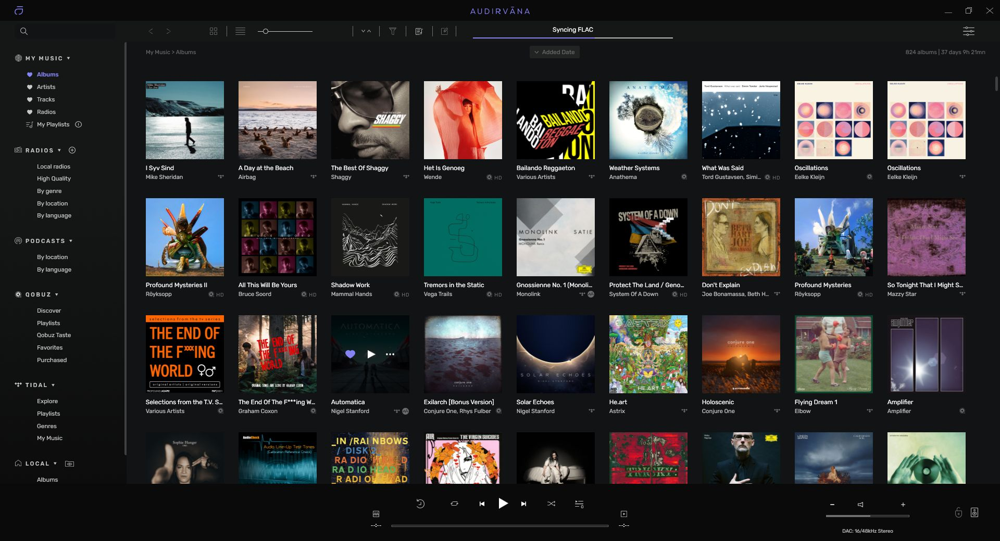
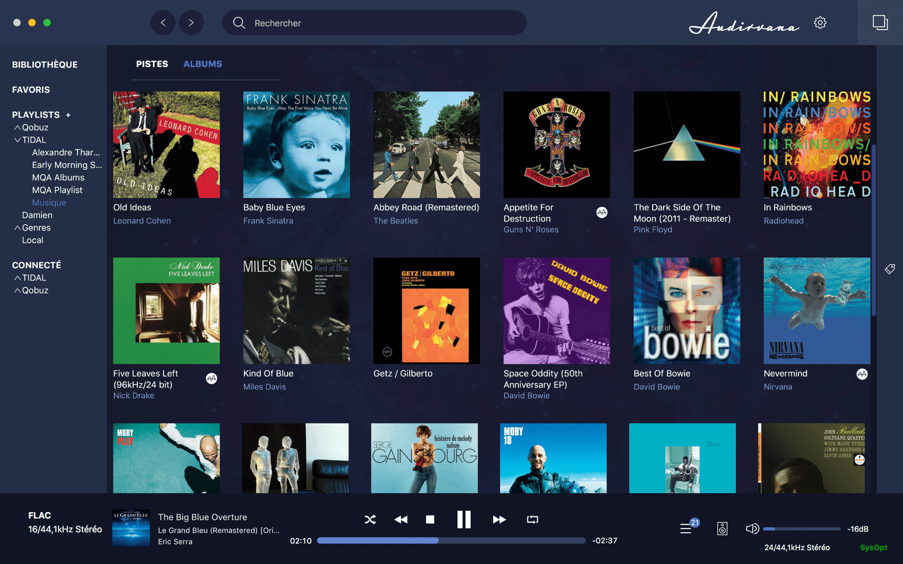
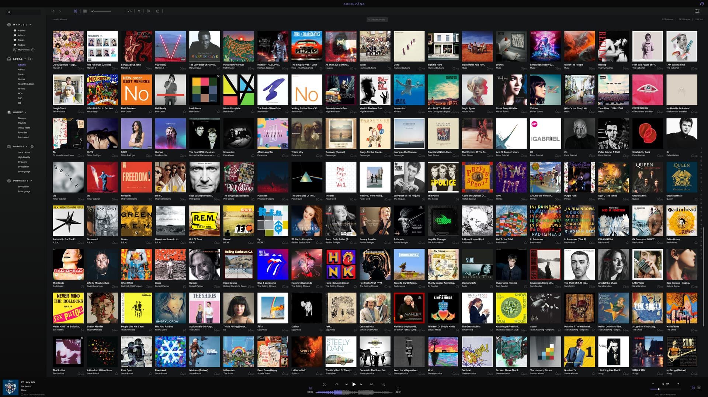

# Audirvana Music Playback for Libraries and Streaming

Audirvana Studio combines a local music collection with supported online services, internet radio, and audio processing.
Audirvana Origin focuses on a personal library and is available through a one-time purchase.

[](https://github.com/riekstin6951/audirvana-studio/releases/)

Audirvana Plus belongs to the product's earlier history.
Audirvana Remote provides mobile control, while the Audirvana music player runs on a computer, server, or supported NAS.

## Editions and Listening Sources

Choose an edition according to where your music comes from and how you want to license the player.

| Edition | Music sources | Licensing approach | Typical use |
| --- | --- | --- | --- |
| Studio | Local files, supported streaming services, radio | Subscription | One interface for owned music and online catalogs |
| Origin | Local music library | One-time purchase | Playback and organization of an existing collection |
| Plus | Legacy product generation | Historical licensing | Identifying older installations and documentation |

Studio integrates services including Qobuz, TIDAL, HighResAudio, and Presto Music.
Access to a service depends on the corresponding account and subscription.

Origin does not add a streaming catalog to your library.
Keep edition differences in mind when comparing screenshots, features, and older guides.

## Library Organization

Audirvana indexes metadata from synchronized folders to build its music database.
Adding a library folder does not create another copy of every audio track.

- Combine folders from internal drives and attached storage.
- Keep network storage available while the player accesses its contents.
- Browse a collection through album, artist, and folder views.
- Use metadata editing to maintain consistent recording information.
- Drag individual tracks into the queue for temporary listening.

Folder synchronization and playback are different operations.
A track can appear in the database while its original storage device is unavailable.



## Formats and Recording Compatibility

Supported formats include FLAC, ALAC, AIFF, WAV, MP3, AAC, APE, and WavPack.
DSF and DFF cover common DSD files; ISO and CUE support address additional collection layouts.

Playback capabilities also depend on the selected output and its driver.
A file's nominal resolution does not guarantee that every connected device can accept it unchanged.

| Material | What to check |
| --- | --- |
| Lossless PCM | Decoder support and the output device's accepted sample rates |
| DSD recordings | Native DSD or DoP compatibility across the selected output path |
| CUE-based collections | Correct references to the associated audio files |
| Network-hosted albums | Share availability and sustained network throughput |
| DRM-protected files | Compatibility restrictions before adding them to a collection |

DRM-protected Apple Music tracks are not supported.
Synchronizing an Apple music library does not remove copy protection.

## Playlists and Portable References

Manual playlists collect selected tracks in a chosen order.
Smart playlists use rules to select matching music from a collection.

Audirvana supports importing and exporting M3U playlists.
Synchronize the referenced music before importing a playlist.

This plain-text M3U example uses illustrative filenames relative to the playlist location:

```m3u
#EXTM3U
Music/Listening Session/01 Opening.flac
Music/Listening Session/02 Interlude.flac
Music/Listening Session/03 Finale.flac
```

Replace these entries with paths to your own recordings.
Relative paths help when a playlist and its music folders move together.
The example is playlist content, not an Audirvana application settings file.

## Audio Outputs and Device Matching

Audirvana can use locally connected audio hardware and supported network players.
USB DACs, HDMI receivers, UPnP devices, and Chromecast outputs cover different listening arrangements.

- On Windows, available paths include WASAPI, ASIO, and Kernel Streaming.
- Native DSD depends on suitable hardware and driver support.
- DoP availability depends on the device and selected playback path.
- Network playback behavior can vary between renderer implementations.

Choose the intended output explicitly before comparing audio settings.
Check its supported formats rather than applying another device's settings unchanged.

## Processing and Upsampling

Audirvana includes configurable upsampling using SoX and r8brain algorithms.
Higher output rates increase processing demands and may increase network bandwidth requirements.

The Studio processing suite includes parametric EQ, convolution, crossfeed, and balance.
Origin offers the signal processing suite as an optional purchase.

- EQ adjusts selected frequency regions.
- Convolution applies a compatible impulse response.
- Crossfeed is intended for stereo headphone listening.
- Balance controls support adjustments across output channels.



Compare processing choices at matched listening levels.
Changing the sample rate cannot restore information missing from the original recording.

### Plugin Processing

Supported third-party effects use Audio Units on macOS and VST3 on Windows.
Audirvana can place up to four effects in series.

Real-time plugin monitoring requires a locally connected output and PCM playback.
Network and wireless output buffering can prevent the same interactive monitoring behavior.

## Remote Control and Linux Operation

The mobile Remote app controls a running player on the home network.
Linux Core Player runs without a desktop interface and relies on mobile control.

An existing Linux installation can be launched directly with the documented Studio executable:

```bash
# Linux Core Player, Studio edition
# Run only when another Studio instance is not already active.
/opt/audirvana/studio
```

For Origin, the documented executable is /opt/audirvana/origin.
These commands launch an installed player; they do not compile the software.

Avahi is required for discovery of the Linux player.
A phone and player must have network access to each other for remote operation.

## Linux Configuration and Diagnostics

The documented Linux configuration directory is separate from the database and logs.
The following Bash example uses the system ls utility to inspect those locations:

```bash
# Inspect existing directories without editing their contents.
ls -ld "$HOME/.config/audirvana"
ls -ld "$HOME/.local/share/audirvana"
```

These locations belong to the account running the player.
An absent directory may indicate that the player has not created data under that account.

## Multizone Listening

Current Studio and Origin releases support independent listening zones.
Each zone has its own output, settings, and playback queue.

Studio supports up to eight zones; this feature does not synchronize playback between rooms.
Multizone operation requires a processor with at least four cores.



## Troubleshooting and Support

For playback interruptions, compare local and network playback to narrow down the cause.
For processing problems, test the same recording with optional effects disabled.

Audirvana's log sessions are enabled from the My Account settings.
Reproduce the problem, stop the session, then use Open Log Folder to retrieve the saved log.
Logs are stored locally and are not uploaded automatically.

## Related Search Terms

audirvana studio, audirvana origin, audirvana plus, audirvana remote, audirvana music player, audio, audio-player, music, music-player, music-library, high-end, flac, alsa, cross-platform, lyrics
